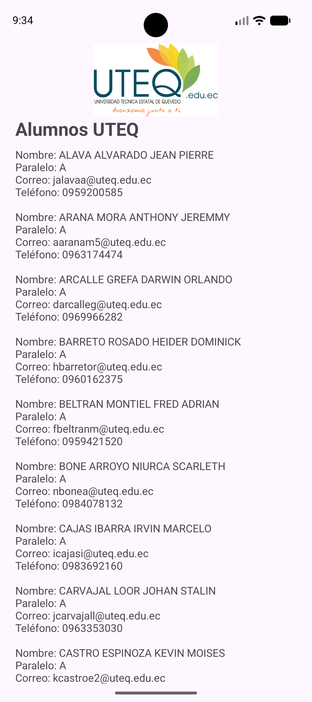
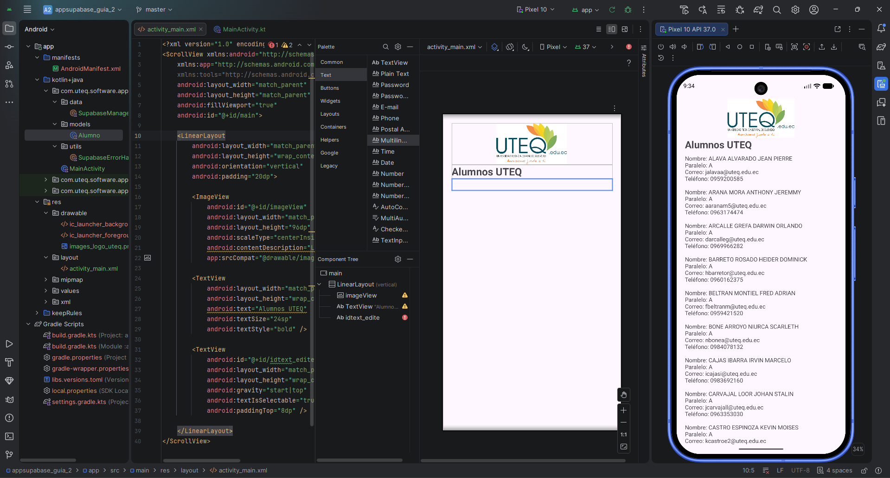

# Práctica 3 – Consumo de API de Supabase en Android

Aplicación Android nativa (Kotlin) que se conecta a un proyecto de **Supabase** y muestra en pantalla el listado de alumnos de la UTEQ (Universidad Técnica Estatal de Quevedo) almacenados en la tabla `alumnos`.

## ¿Qué hace?

1. Al abrir la app (`MainActivity`) se lanza automáticamente una consulta a Supabase.
2. Se leen todos los registros de la tabla `alumnos`, ordenados ascendentemente por `nombres`.
3. Cada registro se decodifica al modelo `Alumno` y se muestra como texto con: **Nombre, Paralelo, Correo y Teléfono** (si faltan, aparece "Sin registrar").
4. Mientras carga se muestra "Cargando alumnos..."; si no hay datos, "No se encontraron alumnos.".
5. Si ocurre un error de red o de consulta, se muestra un diálogo "Error de conexión" con el detalle.

## Estructura del proyecto

```
appsupabase_guia_2/app/src/main/java/com/uteq/software/appsupabase_guia_2/
├── MainActivity.kt                # Pantalla principal; consulta y muestra los alumnos
├── data/SupabaseManager.kt        # Cliente Supabase (singleton) con el módulo Postgrest
├── models/Alumno.kt               # Modelo @Serializable de la tabla alumnos
└── utils/SupabaseErrorHandler.kt  # Diálogo Material para mostrar errores
```

Layout: `res/layout/activity_main.xml` (ScrollView con logo UTEQ, título "Alumnos UTEQ" y un TextView con el listado).

### Modelo `Alumno`

| Campo        | Tipo      | Notas                |
|--------------|-----------|----------------------|
| `id`         | `Long`    |                      |
| `nombres`    | `String`  |                      |
| `paralelo`   | `String`  |                      |
| `correo`     | `String?` | opcional             |
| `telefono`   | `String?` | opcional             |
| `foto`       | `String?` | opcional             |
| `created_at` | `String?` | opcional             |

## Tecnologías

- Kotlin + Android (AppCompat, Material, ConstraintLayout), `minSdk 34`, `compileSdk/targetSdk 37`
- [supabase-kt](https://github.com/supabase-community/supabase-kt) 3.6.0 (`postgrest-kt`)
- Ktor Client Android 3.5.0
- kotlinx-serialization-json 1.9.0
- Corrutinas con `lifecycleScope`

## Cómo ejecutarlo

1. Abrir la carpeta `appsupabase_guia_2` en Android Studio.
2. Sincronizar Gradle.
3. Tener en Supabase una tabla `alumnos` con las columnas del modelo y una política RLS que permita `SELECT` a la clave pública.
4. Ejecutar en un emulador o dispositivo con Android 14 (API 34) o superior.

> La URL y la clave en `SupabaseManager.kt` son la clave *publishable* (pensada para ser pública). Para otros proyectos conviene moverlas a `local.properties`/`BuildConfig`.

## Evidencias

### App en ejecución (emulador Pixel 10, API 37)
Listado de alumnos obtenido desde Supabase.



### Desarrollo en Android Studio
Estructura del proyecto (`data`, `models`, `utils`), el layout `activity_main.xml` y el emulador ejecutando la app.


